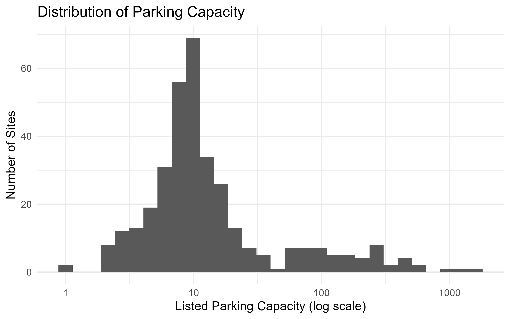

# 1. Problem Statement and Background

For this project, we look to determine whether parking occupancy can be predicted using factors such as the time of day, the day of the week, location, and parking capacity. Our goal is to use recorded parking activity to determine whether these factors can help estimate how full a parking location is likely to be. We will compare predicted occupancy with actual occupancy to determine how well the models perform.

This problem matters to several groups. Drivers benefit from better information about when and where parking is likely to be available. City transportation staff and park managers can use occupancy patterns to identify periods of high demand, locations that are consistently underused, and areas where parking policies or management strategies may need to be reviewed. Better estimates of parking demand may also support decisions about signage, pricing, time restrictions, and how existing parking inventory is distributed. For this project, however, our focus is prediction rather than investigating specific causes of high parking demand.

The City of San Diego has already used parking occupancy data as part of a broader Parking Demand Management Study. Parking observations were collected in June 2024 in selected on-street areas and public parking lots in Balboa Park and Mission Bay. The study was released in January 2025 and was intended to support broader parking-management decisions in the city. This makes the dataset useful for a data science project because the measurements were collected for an actual transportation-planning problem rather than created as a classroom example (City of San Diego, 2025a).

Parking occupancy prediction is also an established research problem. Channamallu, Kermanshachi, Rosenberger, and Pamidimukkala (2023) reviewed more than 100 studies on parking prediction and found that researchers use a range of statistical and machine-learning approaches depending on the available data and the prediction goal. A separate comparative study by Channamallu and colleagues (2023) evaluated several models for parking occupancy and compared their performance using measures such as mean absolute error, root mean square error, and R-squared. These studies show that parking occupancy can be treated as a measurable prediction problem and that model performance can be compared objectively.

For our project, success will be measured by how accurately the models predict parking occupancy at parking sites that were not used to train them. Regression models will be evaluated by the size of their prediction errors and how much variation in occupancy they explain. Classification models will be evaluated by how well they distinguish between full and not-full observations. The final report will compare the models against simple baseline predictions to determine whether the more developed methods provide a meaningful improvement.

# 2. Data and Exploratory Analysis

## Dataset and Target Variable

The primary dataset comes from the City of San Diego Open Data Portal and is titled *Parking Study: counts and percentages of occupied parking spaces*. The data were collected in June 2024 from selected on-street parking areas and off-street public parking lots in Balboa Park and Mission Bay. The original dataset contains 32 features and 919 site-level records.

The field `site_id` serves as an identifier for each parking location, although many parking locations have multiple recordings. The variable `total_inventory` records the listed number of parking spaces at each study site. For every hour from 8 a.m. through 8 p.m., the file contains both the number of occupied spaces and the occupied percentage of total inventory. The variable `day_of_week` identifies whether the observation was collected on Thursday, Saturday, or Sunday.

The project uses two related prediction targets. For regression, the response variable is hourly occupancy percentage. For classification, an observation is labeled as full when occupancy is at or above 100 percent. Using occupancy percentage rather than only the raw number of occupied spaces makes locations with different capacities easier to compare.

The original file is stored in a wide format, with separate columns for each hourly occupancy value. For analysis, the hourly fields are reshaped using `pivot_longer()` from the `tidyr` package into a long format so that each row represents one parking location at a specific hour on a specific day. The long-format data retain `site_id`, `total_inventory`, day, region, and hourly occupancy so the same variables can be used consistently in exploratory analysis and modeling.

## Initial Cleaning and Preparation

The first cleaning step was to verify data types. Using `readr`, data types are automatically identified when the file is loaded. One unusual case is `site_id`, which is stored as a decimal value rather than an integer because some site identifiers contain decimal values such as 38.1.

There were 114 missing values for `description` and `orientation`. These belonged to parking locations labeled as lots rather than specific streets. The remaining descriptions generally referred to street intersections where orientation was meaningful. Because orientation may not apply to off-street parking lots, these missing values were kept as `NA`.

There were also missing occupancy percentage values associated with observations where `total_inventory` was zero. Since an occupancy percentage cannot be calculated when the parking capacity is zero, these observations are excluded from the modeling data.

Additional columns were created to place locations into broader geographic categories such as neighborhoods and regions. These categories allow parking locations in similar areas to be grouped during exploratory analysis and modeling.

Several occupancy entries were slightly greater than the listed maximum capacity of the parking location. The largest difference was six vehicles above the listed inventory. These observations were retained because they may represent actual over-capacity parking, differences in how vehicles were recorded, or vehicles parked outside designated spaces. Capping them at 100 percent would change the observed regression target and remove information from the highest-demand observations.

There are also several large values for `total_inventory` because some parking lots are much larger than the majority of locations in the study. These observations appear to represent legitimate parking facilities rather than errors and were retained.

The R packages used to load, clean, and prepare the data were `readr`, `dplyr`, `tidyr`, and `ggplot2`. The `read_csv()` function from `readr` was used to load the data. The `pivot_longer()` function from `tidyr` was used to reshape the hourly data. `dplyr` was used for filtering, grouping, summarizing, and piping operations together. `ggplot2` was used to create the exploratory plots.

## Key Exploratory Plots

### Parking Capacity Distribution

The original capacity boxplot made the middle of the distribution visible only by hiding the large outlier points. Based on Deliverable 1 feedback, this was replaced with a histogram displayed on a logarithmic capacity scale so that the full range remains visible.

For site-level capacity analysis, each `site_id` is represented once. A small number of sites have slightly different `total_inventory` values across repeated records, so the median recorded inventory for each site is used as its representative capacity for this exploratory analysis.

After removing zero-capacity records, there are 350 unique sites. Capacity ranges from 1 to 1,595 spaces, with Q1 of 7, a median of 10, and Q3 of 17 spaces. This confirms that the capacity distribution is strongly right-skewed rather than showing that the large facilities are simply errors.

{width=80%}

*Figure 1. Distribution of listed parking capacity across the 350 unique study sites. The horizontal axis uses a logarithmic scale so both small and very large facilities remain visible.*

### Mean Hourly Parking Occupancy by Day

The hourly occupancy plot shows that average occupancy changes throughout the day and differs across the observed days. Weekend observations generally have higher average occupancy than Thursday, with Sunday highest during several midday hours.

Sunday observations were collected only at selected locations, and Sunday 8 p.m. occupancy is missing, so the Sunday line ends at 7 p.m. rather than treating missing values as zero.

{width=90%}

*Figure 2. Mean hourly parking occupancy by day of week for available observations. Sunday has no 8 p.m. value because those measurements are missing in the source data.*

### Percentage of Parking Locations at Maximum Capacity

The maximum-capacity plot was also revised after Deliverable 1 feedback. The earlier version stacked the percentages for different days, which could incorrectly imply that the day-specific percentages should be added together. The revised plot places the day-specific bars side by side so the values can be compared independently at each hour.

{width=90%}

*Figure 3. Percentage of observed parking locations at or above 100 percent occupancy by hour and day. Bars are shown side by side rather than stacked.*

## Occupancy by Location

Because geographic location is used as a predictor, occupancy was also summarized by region. The values below are descriptive averages across the available hourly observations, not evidence that the region itself causes the occupancy differences.

| Region | Mean Occupancy | Unique Sites |
|---|---:|---:|
| Pacific Beach | 84.4% | 23 |
| Downtown | 76.1% | 66 |
| Greater Golden Hill | 73.9% | 6 |
| Old Town | 73.2% | 18 |
| Uptown | 70.4% | 18 |
| Balboa Park | 63.1% | 16 |
| Mid-City | 61.2% | 90 |
| North Park | 59.8% | 27 |
| Park lot (Mission Bay or Balboa Park) | 57.5% | 57 |
| College Area / Mid-City | 43.5% | 27 |
| College Area | 40.4% | 2 |

The regional averages vary substantially, which supports retaining region as a model predictor. The number of sites is also very different across regions, so these averages should be interpreted with the sampling structure in mind.

## Occupancy by Parking Capacity

Parking capacity was explored directly because it is part of the project question and is now included in the predictive models. A small number of sites have slightly different `total_inventory` values across repeated records. For this site-level exploratory analysis, each `site_id` is assigned one representative capacity using the median of its recorded inventory values. This prevents a single site from being counted in more than one capacity group.

| Listed Capacity | Mean Occupancy | Unique Sites |
|---|---:|---:|
| 1-5 spaces | 66.9% | 54 |
| 6-10 spaces | 70.4% | 135 |
| 11-20 spaces | 62.1% | 86 |
| 21-50 spaces | 70.0% | 21 |
| 51-100 spaces | 57.6% | 18 |
| 101+ spaces | 57.2% | 36 |

The six groups contain 350 unique sites in total. The relationship is not monotonic, but the larger capacity groups have lower average occupancy than several of the smaller groups.

Because capacity ranges from 1 to 1,595 spaces and is strongly right-skewed, the models use `log(1 + total_inventory)` rather than raw capacity. This keeps the capacity information while reducing the influence of the very largest facilities on scale-sensitive models.

## Limitations

These data are useful for comparing parking activity across sites and hours, but there are clear limitations that need to be considered when interpreting the results. The observations were collected during June 2024, with Thursday and Saturday observations collected across the study areas and Sunday observations limited to selected locations.

Because the same locations were not necessarily observed on all three days, differences between days may be influenced by both the day of the week and the locations included in the sample. Sunday 8 p.m. occupancy is also missing for the Sunday observations.

The results should therefore not be assumed to represent every season, weekday, or parking location in San Diego.

# 3. Methods

## Data Preparation for Modeling

The models use the long-format dataset produced during cleaning and exploratory analysis. Each row represents a parking location at a particular hour. Observations without a valid occupancy percentage are removed before modeling.

Time of day is converted from the original hourly column names into a numeric value ranging from 8 through 20. Day of the week and geographic region are treated as categorical predictors.

Parking capacity is retained as a predictor and transformed as `log(1 + total_inventory)` because the original capacity distribution is strongly right-skewed. Models that require numeric inputs convert categorical variables into dummy variables, and scale-sensitive models normalize numeric predictors.

The common predictor set is therefore:

- numeric time of day
- day of week
- geographic region
- log-transformed parking capacity

For regression, the response variable is the recorded occupancy percentage and values above 100 percent are retained.

For classification, the response is converted into two classes:

- `Full` when occupancy is at or above 100 percent
- `NotFull` when occupancy is below 100 percent

The classification variable is the response being predicted and is not used as an input predictor.

The same fixed random seed is used throughout the project:

```r
set.seed(12345)