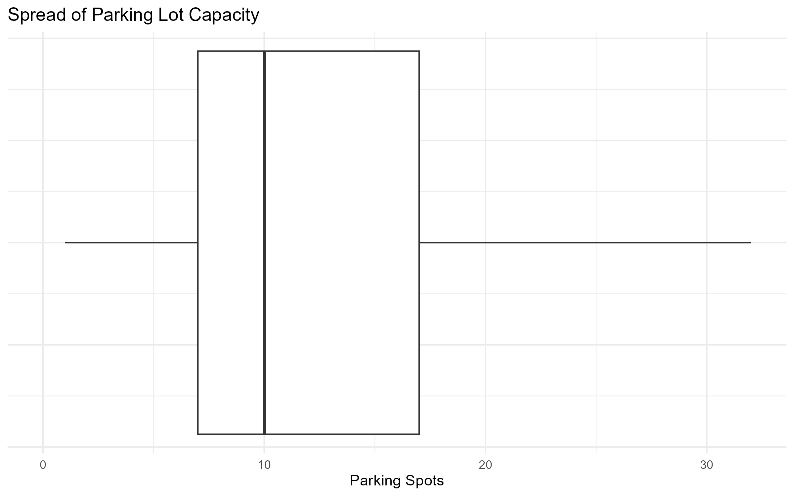
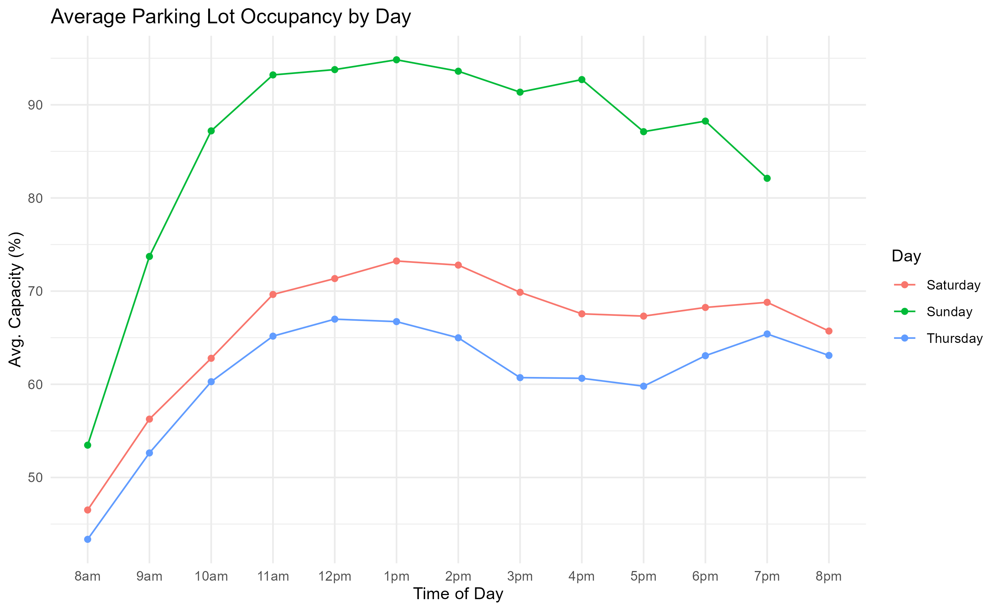
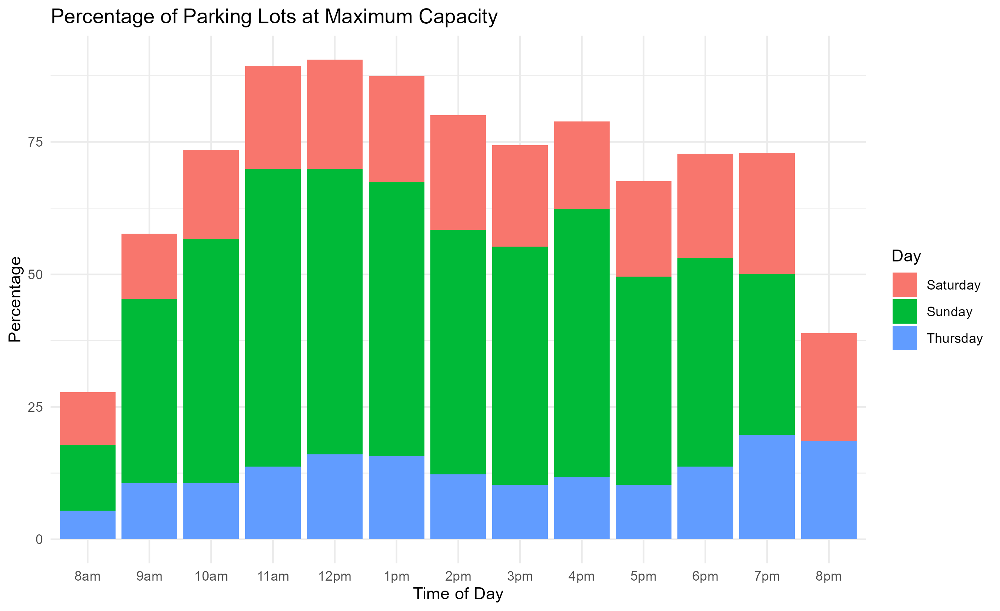

# 1. Problem Statement and Background

For this project, we look to determine whether parking occupancy can be predicted using factors such as the time of day, the day of the week, location, and parking capacity. Our goal is to use recorded parking activity to determine whether these factors can help estimate how full a parking location is likely to be. We will compare predicted occupancy with actual occupancy to determine how well the models perform.

This problem matters to several groups. Drivers benefit from better information about when and where parking is likely to be available. City transportation staff and park managers can use occupancy patterns to identify periods of high demand, locations that are consistently underused, and areas where parking policies or management strategies may need to be reviewed. Better estimates of parking demand may also support decisions about signage, pricing, time restrictions, and how existing parking inventory is distributed. For this project, however, our focus is prediction rather than investigating specific causes of high parking demand.

The City of San Diego has already used parking occupancy data as part of a broader Parking Demand Management Study. Parking observations were collected in June 2024 in selected on-street areas and public parking lots in Balboa Park and Mission Bay. The study was released in January 2025 and was intended to support broader parking-management decisions in the city. This makes the dataset useful for a data science project because the measurements were collected for an actual transportation-planning problem rather than created as a classroom example (City of San Diego, 2025a).

Parking occupancy prediction is also an established research problem. Channamallu, Kermanshachi, Rosenberger, and Pamidimukkala (2023) reviewed more than 100 studies on parking prediction and found that researchers use a range of statistical and machine-learning approaches depending on the available data and the prediction goal. A separate comparative study by Channamallu and colleagues (2023) evaluated several models for parking occupancy and compared their performance using measures such as mean absolute error, root mean square error, and R-squared. These studies show that parking occupancy can be treated as a measurable prediction problem and that model performance can be compared objectively.

For our project, success will be measured by how accurately the models predict parking occupancy for observations that were not used to train them. Regression models will be evaluated by the size of their prediction errors and how much variation in occupancy they explain. Classification models will be evaluated by how well they distinguish between full and not-full observations. The final report will compare the models against simple baseline predictions to determine whether the more developed methods provide a meaningful improvement.

# 2. Data and Exploratory Analysis

## Dataset and Target Variable

The primary dataset comes from the City of San Diego Open Data Portal and is titled *Parking Study: counts and percentages of occupied parking spaces*. The data were collected in June 2024 from selected on-street parking areas and off-street public parking lots in Balboa Park and Mission Bay. The original dataset contains 32 features and 919 site-level records.

The field `site_id` serves as an identifier for each parking location, although many parking locations have multiple recordings. The variable `total_inventory` records the maximum number of parking spaces at each study site. For every hour from 8 a.m. through 8 p.m., the file contains both the number of occupied spaces and the occupied percentage of total inventory. The variable `day_of_week` identifies whether the observation was collected on Thursday, Saturday, or Sunday.

The project uses two related prediction targets. For regression, the response variable is hourly occupancy percentage. For classification, an observation is labeled as full when occupancy is at or above 100 percent. Using occupancy percentage rather than only the raw number of occupied spaces makes locations with different capacities easier to compare.

The original file is stored in a wide format, with separate columns for each hourly occupancy value. For analysis, the hourly fields are reshaped using `pivot_longer()` from the `tidyr` package into a long format so that each row represents one parking location at a specific hour on a specific day. This structure makes it easier to graph occupancy over time and use time, day, and location-related information as predictors.

## Initial Cleaning and Preparation

The first cleaning step was to verify data types. Using `readr`, data types are automatically identified when the file is loaded. One unusual case is `site_id`, which is stored as a decimal value rather than an integer because some site identifiers contain decimal values such as 38.1.

There were 114 missing values for `description` and `orientation`. These belonged to parking locations labeled as lots rather than specific streets. The remaining descriptions generally referred to street intersections where orientation was meaningful. Because orientation may not apply to off-street parking lots, these missing values were kept as `NA`.

There were also missing occupancy percentage values associated with observations where `total_inventory` was zero. Since an occupancy percentage cannot be calculated when the parking capacity is zero, these observations are excluded from the modeling data.

Additional columns were created to place locations into broader geographic categories such as neighborhoods and regions. These categories allow parking locations in similar areas to be grouped during exploratory analysis and modeling.

Several occupancy entries were slightly greater than the listed maximum capacity of the parking location. The largest differences were only a small number of vehicles above capacity. These observations were retained because they may represent actual over-capacity parking, differences in how vehicles were recorded, or vehicles parked outside designated spaces.

There are also several large values for `total_inventory` because some parking lots are much larger than the majority of locations in the study. These observations appear to represent legitimate parking facilities rather than errors and were therefore retained. Occupancy percentages greater than 100 percent were also retained instead of being capped at 100 percent.

The R packages used to load, clean, and prepare the data were `readr`, `dplyr`, `tidyr`, and `ggplot2`. The `read_csv()` function from `readr` was used to load the data. The `pivot_longer()` function from `tidyr` was used to reshape the hourly data. `dplyr` was used for filtering, grouping, summarizing, and piping operations together. `ggplot2` was used to create the exploratory plots.

## Key Exploratory Plots

### Parking Lot Capacity Distribution

The first plot is a boxplot showing the capacity of the parking locations. Outlier points were hidden from the visualization so that the main distribution could be seen more clearly. The observations themselves were not removed from the dataset.

The five-number summary shows a minimum of 1 parking spot, Q1 of 7 parking spots, a median of 10 parking spots, Q3 of 17 parking spots, and an upper non-outlier value of 31 parking spots. The middle 50 percent of parking locations therefore contain between 7 and 17 spaces. This suggests that most locations in the study are relatively small, while several much larger parking facilities exist as outliers.

{width=75%}

*Parking lot capacity distribution for the study locations.*

\newpage

### Mean Hourly Parking Occupancy by Day

The second graph shows the mean hourly occupancy for each day of the week included in the study. Weekend observations appear to have higher occupancy than Thursday, with Sunday showing the highest observed occupancy during several hours of the day. Sunday observations were collected only at selected locations, so these differences may reflect both the day of the week and the locations included in the Sunday sample.

{width=85%}

*Mean hourly parking occupancy by day of week for the observations included in the study.*

### Percentage of Parking Locations at Maximum Capacity

The final plot shows the percentage of parking locations in the study that reached maximum capacity throughout the day. The percentage was higher than initially expected, but the overall pattern shows lower occupancy during the morning and late afternoon compared with the middle of the day. Sunday again appears to have the highest proportion of full parking locations, while Thursday generally appears to have the lowest.

{width=85%}

*Percentage of observed parking locations at or above maximum capacity throughout the day.*

## Limitations

These data are useful for comparing parking activity across sites and hours, but there are clear limitations that need to be considered when interpreting the results. The observations were collected during June 2024, with Thursday and Saturday observations collected across the study areas and Sunday observations limited to selected locations. Because the same locations were not necessarily observed on all three days, differences between days may be influenced by both the day of the week and the locations included in the sample. The results should therefore not be assumed to represent every season, weekday, or parking location in San Diego.

# 3. Methods

## Data Preparation for Modeling

The models use the long-format dataset produced during the cleaning and exploratory analysis. Each row represents a parking location at a particular hour. Observations without a valid occupancy percentage are removed before modeling.

Time of day is converted from the original hourly column names into a numeric value ranging from 8 through 20. Day of the week and geographic region are treated as categorical predictors. Models that require numeric inputs convert the categorical variables into dummy variables.

The current models use time of day, day of week, and geographic region as the main predictors. Parking capacity remains part of the broader project question and exploratory analysis, but the current model scripts use the common predictor set so that the different methods can be compared under the same general conditions.

For regression, the response variable is the recorded occupancy percentage. Values above 100 percent are retained. For classification, the response is converted into two classes:

- `Full` when occupancy is at or above 100 percent
- `NotFull` when occupancy is below 100 percent

The same fixed random seed is used throughout the project:

```r
set.seed(12345)
```

The data are split into approximately 80 percent training data and 20 percent held-out testing data. Full and not-full status is used for stratification so that high-occupancy observations remain represented in both portions of the data.

## Baseline Models

Simple baseline models are included so the team can determine whether the predictive models actually improve on an easy prediction strategy.

For regression, the main baseline predicts the mean occupancy value from the training data for every test observation. Linear regression is also included as a simple statistical model.

For classification, the simplest baseline predicts the majority class for every observation. Since most observations are not full, this baseline predicts `NotFull`. Logistic regression is also included as a basic classification model.

These baselines are important because raw model performance is more meaningful when compared against a simple alternative.

## Regression Models

The regression models predict parking occupancy percentage.

### Linear Regression

Linear regression provides a straightforward model of the relationship between occupancy and the selected predictors. It also gives the team a simple statistical model to compare against more flexible methods.

### Nonlinear Regression

The nonlinear regression model adds a squared time term to the linear regression model. This allows the relationship between time of day and occupancy to curve rather than forcing the change in occupancy to follow one straight-line pattern.

### k-Nearest Neighbors Regression

The kNN regression model predicts occupancy using observations that are close to one another in the predictor space. Numeric predictors are normalized and categorical variables are converted to dummy variables before fitting the model.

The number of neighbors is tuned using 10-fold cross-validation. Odd values of `k` from 1 through 51 are tested, and the value with the lowest cross-validation RMSE is selected.

### Decision Tree Regression

The decision tree regression model divides the predictor space into smaller groups based on conditions involving time, day, and region. This allows the model to capture relationships that do not need to follow a straight line.

### Random Forest Regression

Random forest regression combines many decision trees. This can reduce the instability of a single tree and allow the model to capture more complicated relationships in the data.

## Classification Models

The classification models predict whether a parking observation is full or not full.

### Logistic Regression

Logistic regression provides a simple probabilistic classification model and serves as a useful comparison for the more complex classification methods.

### k-Nearest Neighbors Classification

The kNN classification model uses nearby observations to determine whether a new observation should be classified as full or not full.

Numeric predictors are normalized and categorical variables are converted to dummy variables. Odd values of `k` from 1 through 51 are evaluated using 10-fold cross-validation, and the model is tuned using ROC-AUC.

### Decision Tree Classification

The decision tree classifier creates a sequence of rules that divide observations into full and not-full groups. This provides a model that can represent interactions and nonlinear relationships between predictors.

### Random Forest Classification

The random forest classifier combines multiple classification trees. The goal is to improve predictive stability and reduce the dependence on one individual tree.

### Support Vector Machine Classification

A linear support vector machine is also used for classification. The SVM is implemented with the `LiblineaR` package.

The classification dataset contains substantially more `NotFull` observations than `Full` observations. Because of this imbalance, the SVM uses class weighting so that errors involving the less common `Full` class receive more weight during training.

Different cost values are evaluated using 10-fold cross-validation. Balanced accuracy is used during tuning so that performance on both classes is considered instead of allowing the majority class to dominate model selection.

## Model Evaluation

Regression models are evaluated using:

- root mean squared error (RMSE)
- mean absolute error (MAE)
- R-squared

RMSE measures the typical size of the prediction error while giving more weight to larger errors. MAE measures the average absolute difference between the prediction and actual occupancy. Lower RMSE and MAE values are better.

R-squared measures how much variation in occupancy is explained by the model. Higher values indicate that the model explains more of the observed variation.

Classification models are evaluated using:

- accuracy
- precision
- recall
- specificity
- F1 score
- balanced accuracy
- confusion matrices
- ROC-AUC when available

Using several classification metrics is important because the target is imbalanced. A model can receive high accuracy by predicting `NotFull` most of the time while still failing to identify most of the actually full parking observations.

Recall measures how many actual full observations are detected. Precision measures how often a predicted full observation is actually full. F1 combines precision and recall. Balanced accuracy gives equal importance to performance on the two classes.

The complete model results and comparisons will be reported in the Results section of the final report.

# 4. Tools and Reproducibility

## Software and Tools

The analysis is completed in R. The current project environment uses R 4.6.1.

RStudio and Visual Studio Code are used to edit and run the project files. Git and GitHub are used for version control and team collaboration. Quarto is used to maintain the written report and render it as a PDF.

The repository is hosted on GitHub:

<https://github.com/iqtider/Data-Science-Project>

## R Packages

The main packages used in the project are:

- `tidyverse` for data manipulation and general analysis
- `readr` for loading CSV files
- `dplyr` for filtering, grouping, and summarizing data
- `tidyr` for reshaping the hourly parking data
- `ggplot2` for exploratory visualizations
- `tidymodels` for data splitting, recipes, workflows, cross-validation, and evaluation
- `kknn` for k-nearest neighbors
- `rpart` for decision trees
- `ranger` for random forests
- `LiblineaR` for the support vector machine

The required packages are listed in `requirements.R`. The script checks the installed packages and installs any that are missing.

The SVM was originally planned using another SVM package, but installation problems occurred in the current R environment. `LiblineaR` was used instead and successfully supported the linear SVM needed for the project.

Some installed packages report that they were built under R 4.6.2 while the project is currently being run with R 4.6.1. These warnings have not prevented the scripts from running.

## Repository Structure

The current repository is organized as follows:

```text
Data-Science-Project/
├── Parking.R
├── LinearRegression.R
├── NonlinearRegression.R
├── LogisticRegression.R
├── KNNRegression.R
├── KNNClassification.R
├── DecisionTreeRegression.R
├── DecisionTreeClassification.R
├── SVMClassification.R
├── requirements.R
├── README.md
├── parking_study_occupancy_datasd.csv
├── parking_with_regions.csv
├── FinalProject.Rproj
└── docs/
    ├── CSC3220 Team8 Deliverable2.qmd
    └── images/
        ├── parking_capacity_boxplot.png
        ├── hourly_occupancy_by_day.png
        └── maximum_capacity_by_hour.png
```

`Parking.R` performs the main data loading, cleaning, reshaping, and exploratory analysis.

Each model is stored in a separate R file so that it can be run and tested independently.

## Reproducing the Analysis

First, clone the repository or download the project and open a terminal in the repository folder.

The required R packages can be checked and installed with:

```powershell
Rscript --vanilla .\requirements.R
```

The main data preparation and exploratory analysis can be run with:

```powershell
Rscript --vanilla .\Parking.R
```

Individual models can then be run separately.

For example:

```powershell
Rscript --vanilla .\LinearRegression.R
```

The same command format can be used for the other model files:

```text
NonlinearRegression.R
LogisticRegression.R
KNNRegression.R
KNNClassification.R
DecisionTreeRegression.R
DecisionTreeClassification.R
SVMClassification.R
```

The project uses the random seed:

```r
set.seed(12345)
```

The Deliverable 2 PDF can be rendered from the repository root with:

```powershell
quarto render "docs/CSC3220 Team8 Deliverable2.qmd"
```

If `Rscript` or `quarto` is not recognized, the user can run the files through RStudio or configure the local R or Quarto installation on that computer. Personal computer paths are not hard-coded into the shared repository.

# References

Channamallu, S. S., Kermanshachi, S., Rosenberger, J. M., & Pamidimukkala, A. (2023). Parking occupancy prediction and analysis: A comprehensive study. *Transportation Research Procedia, 73*, 297-304. https://doi.org/10.1016/j.trpro.2023.11.921

Channamallu, S. S., Padavala, V. K., Kermanshachi, S., Rosenberger, J. M., & Pamidimukkala, A. (2023). Examining parking occupancy prediction models: A comparative analysis. *Transportation Research Procedia, 73*, 281-288. https://doi.org/10.1016/j.trpro.2023.11.919

City of San Diego. (2025a). *Parking Study: counts and percentages of occupied parking spaces*. City of San Diego Open Data Portal. https://data.sandiego.gov/datasets/parking-study-occupancy/

City of San Diego. (2025b). *Parking Study: average occupancy by site*. City of San Diego Open Data Portal. https://data.sandiego.gov/datasets/parking-study-summary/

City of San Diego. (2025c). *Parking Demand Management Study*. Transportation Department. https://www.sandiego.gov/sites/default/files/2025-02/bpcagenda20250306-item5.pdf